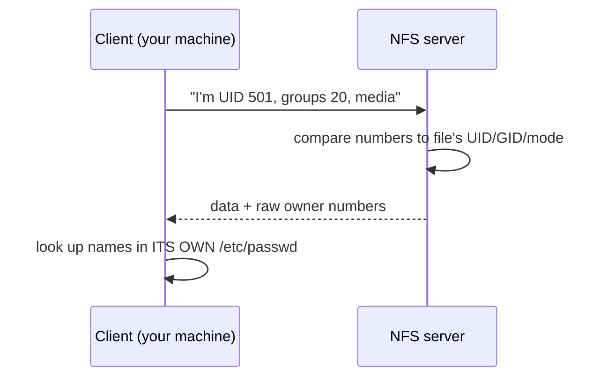

# Cross-Machine Identity (UID/GID Mapping)

**Big picture:** the general topic is **identity mapping across machines**, also called UID/GID mapping or ID mapping. Files carry numbers; each machine has its own list of names. Whether "501" means the same person everywhere depends on how you copy or share the files.

Related: [Users, groups, permissions](users-groups-permissions.md) · [UID/GID ranges](uid-gid-ranges.md) · [NFS security](nfs-security.md) · [umask](umask.md)

## Terms

ID mapping
: Turning a user/group on one machine into the right user/group on another.

Squashing
: NFS replacing a client's claimed UID with another (usually `nobody`).

SSSD
: Linux service that pulls users/groups from a central directory (LDAP, FreeIPA, AD).

## Copying over SSH (scp, rsync)

- You log in as some remote user, so copied files are **owned by that remote user**, with modes from their umask.
- Exception: `rsync -a` running as **root** on the receiving end keeps ownership, mapped by **name** by default, or by raw **number** with `--numeric-ids`.

```bash
sudo rsync -a --numeric-ids src/ host:/dst/
```

## NFS (sec=sys)



- Access is decided by **numbers matching** on the server.
- Names you see in `ls -l` come from **your client's** user list.

| Situation | What you see | Risk |
|---|---|---|
| Same number, same person | correct name | none |
| Number unknown on your machine | raw number, e.g. `501` | cosmetic |
| Same number, different person | wrong name | **that person has your access** |

```bash
id -u                 # on the Mac → 501
getent passwd 501     # on Linux → nothing = no local user
ls -n /mnt/media      # raw UID/GID
```

## When names have to match

The server stores numbers. `getent group` on a machine is that machine's names. `ls -n` on a mount shows the stored numbers. The server's own names are only visible on the server.

A shared group only has to exist where files are created. Another machine needs that same GID when it also creates files, or when you want `ls` there to show the same name.

A central directory (LDAP, FreeIPA, AD with SSSD) is how several machines share one name table. [`sec=krb5`](nfs-security.md) does not do that job. It stops a client from lying about its UID.

Squashing (`all_squash,anonuid=<uid>,anongid=<gid>`) collapses every client to one identity. That fits a share with no per-user ownership.

## Rewriting numbers already on the share

```bash
sudo chgrp -R media /mnt/media
sudo find /mnt/media -type d -exec chmod g+s {} +
sudo chown -R --from=501 1000 /mnt/media
```

`chgrp` leaves the owner. `chown --from` touches only that UID and leaves the group. Both change the number stored on the share. Other machines then look that new number up in their own name tables.

## SMB is different

SMB (Samba, Windows shares, macOS file sharing) authenticates you **by username and password**, and the **server** maps that name to its own UID. Client numbers don't matter.

## Key takeaways

- Numbers decide access; names are local labels.
- scp/rsync normally re-own files as the remote login user.
- NFS sec=sys trusts the client's numbers.
- A shared group has to exist where files are created. A central directory is for several machines that need the same names.

## Gotchas

- Changing a UID later doesn't re-own existing files. `chown -R --from=OLD NEW` does, and it leaves the group.
- macOS default group is `staff` (GID 20), which won't match Linux.
- NFSv4 can map by name (`idmapd`) but with sec=sys the actual check is still numeric.
