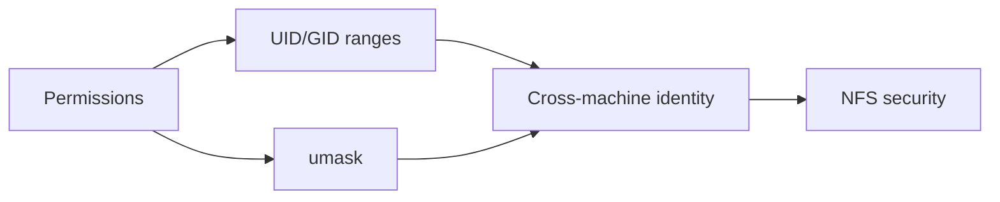

# Linux

**Big picture:** the general model of who owns a file and who can touch it, on one machine and then across machines. Later sections are learnings that still apply outside the situation that produced them.

## Reading order

1. [Users, groups, and permissions](users-groups-permissions.md): owners, groups, modes, and how access is checked.
2. [umask](umask.md): what mode new files get.
3. [UID and GID ranges](uid-gid-ranges.md): why a UID is 1000 on Linux and 501 on a Mac.
4. [Cross-machine identity](cross-machine-identity.md): what happens to ownership with scp, rsync, NFS, and SMB.
5. [NFS security](nfs-security.md): what `sec=sys` trusts, and where the boundary actually is.

## Related

- [Container namespaces](../containers/namespaces.md): user namespaces remap UIDs inside containers, the same idea as ID mapping.
