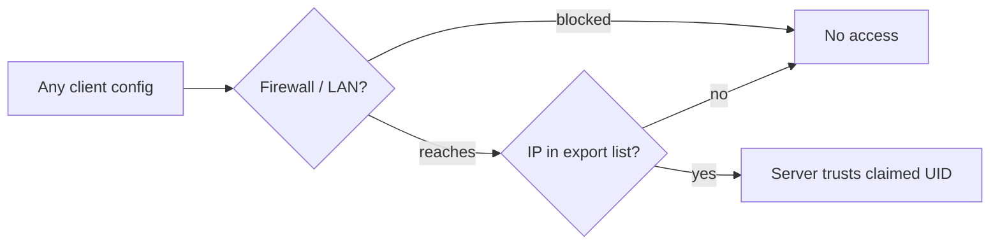

# NFS Security

**Big picture:** with `sec=sys`, the NFS server believes whatever UID a client claims. So the real security boundary is **which machines may mount the share**, not which users.

Related: [Cross-machine identity](cross-machine-identity.md) · [UID/GID ranges](uid-gid-ranges.md)

## Terms

sec
: Security flavor: how the client proves who is making a request.

AUTH_SYS (AUTH_UNIX)
: What `sys` means: the client sends UID + GIDs, the server trusts them.

KDC
: Key Distribution Center, the Kerberos server that issues tickets.

root_squash
: Default export option that maps client root (UID 0) to `nobody`.

## Security flavors

| Option | Adds |
|---|---|
| `sec=sys` | nothing; claimed IDs trusted |
| `sec=krb5` | user identity proven by Kerberos ticket |
| `sec=krb5i` | + **integrity**: requests signed, tamper-proof |
| `sec=krb5p` | + **privacy**: traffic encrypted |

All krb5 options need a KDC with the server and each client enrolled.

## `nfsvers` does not choose `sec`

`nfsvers=4.1` is the protocol version. `sec=` is how the client proves identity. They are independent. A mount that only sets the version still uses `sec=sys`, because `sys` is the default when no flavor is named. Kerberos on that same mount is an explicit `sec=krb5`.

If `mount` shows `sec=sys` and the fstab never says `sec=`, that is the default. `nfsstat -m` shows the options actually in use.

## The security boundary

Anyone with root on an allowed client (or who can put a device in an allowed IP range) can:

> `useradd -u 501 fake && su fake && ls /mnt/media` → treated as owner of the `501` files.

`root_squash` stops client root acting as *root* but not from becoming 501.

## Two halves of a mount

**Server (export):** `/etc/exports`, or the NAS GUI.

```
/srv/media  192.168.1.0/24(rw,sync,root_squash,sec=sys)
```

```bash
cat /etc/exports
sudo exportfs -v      # what's actually exported
```

**Client (mount):** `/etc/fstab` on Linux; `/etc/auto_master` or Finder "Connect to Server" on a Mac.

```
nas:/srv/media  /mnt/media  nfs  sec=sys  0 0
```

```bash
mount | grep nfs
nfsstat -m            # Linux: options in use
```

The client config is **only a request**. Anyone can write their own; the server's export decides.



## Home network, no Kerberos

`sec=sys` is the usual choice on a LAN you already trust. The boundary is still the export list, not the UID:

- Export to the clients that mount (`192.168.1.10`), not `192.168.1.0/24`. A phone or guest on the Wi-Fi then cannot mount, so it never gets to claim a UID.
- Keep `root_squash`. It stops a client claiming UID 0. It does not stop a client claiming 501.
- Use `664` and `775` with a shared group. Mode `777` is writable by anyone who can mount, without claiming a UID.
- Put guests on their own subnet. The Wi-Fi password is the front door. The export list is what stops every device inside that door from being an NFS client.

`sec=krb5` moves the boundary from "this IP may mount" to "this authenticated user." That is the step when untrusted devices share the subnet, not the default for one trusted writer.

## Key takeaways

- `sys` = trust the client; `krb5*` = prove it.
- Leaving `sec=` off means `sys`, on any NFS version.
- With sec=sys, secure the *hosts*, not the users.
- On a home LAN the standard scope is a per-host export, `root_squash`, and normal modes.

## Gotchas

- A `/24` export lets any device on that Wi-Fi mount the share.
- `no_root_squash` hands remote root full control; avoid it.
- `777` is writable without faking a UID.
- krb5p encrypts but costs CPU; krb5i only signs.
