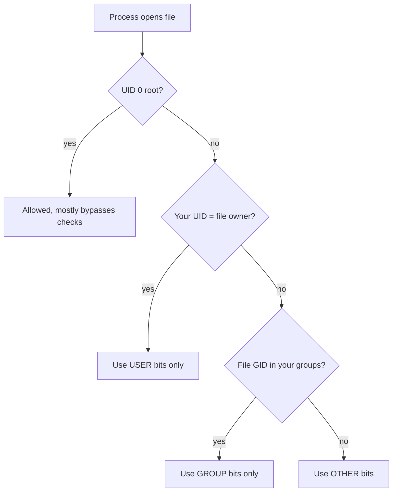

# Users, Groups, and Permissions

**Big picture:** every file stores three things: an **owner** (a number), a **group** (a number), and a **mode** (permission bits). When you touch a file, Linux puts you in exactly one slot (user, group, or other) and checks only that slot's bits.

Related: [umask](umask.md) · [UID/GID ranges](uid-gid-ranges.md) · [Cross-machine identity](cross-machine-identity.md)

## Terms

UID
: User ID. The number that *is* a user. `ada` is just a label for it.

GID
: Group ID. The number that *is* a group, e.g. `media`.

Mode
: The permission bits on a file, written as octal (`644`) or letters (`rw-r--r--`).

## Ownership is numbers; names are local lookups

On disk a file holds only a UID and GID. Each machine turns those into names using **its own** `/etc/passwd` and `/etc/group` (or LDAP/SSSD).

```bash
ls -l  file   # names (looked up locally)
ls -n  file   # raw numbers
id            # your UID, GID, and groups
```

## rwx bits and octal math

| Bit | Value | On a file | On a directory |
|---|---|---|---|
| `r` | 4 | read contents | list names |
| `w` | 2 | modify | create/delete/rename entries |
| `x` | 1 | run it | enter (`cd`) / access entries |

Add the bits per slot: `rwx` = 4+2+1 = 7, `r-x` = 5, `rw-` = 6, `r--` = 4.

## A mode covers all three slots

A mode is **one number for the whole file**, digits read left to right as user, group, other. It's not "file 755 / group 644"; `755` already includes the group's `5`.

| Mode | user | group | other | Typical use |
|---|---|---|---|---|
| `755` | rwx | r-x | r-x | scripts, directories |
| `644` | rw- | r-- | r-- | normal files |
| `775` | rwx | rwx | r-x | shared team directories |
| `664` | rw- | rw- | r-- | shared team files |

## Reading `ls -l`

> `-rwxr-xr-x 1 ada media 120 Oct 18 run.sh`
>
> `-` type (`d` = directory) · `rwx` user · `r-x` group · `r-x` other → **755**

## Changing it

```bash
chmod 644 notes.txt        # octal
chmod g+w,o-r notes.txt    # symbolic: add group write, remove other read
chown ada:media notes.txt  # owner and group (needs root to change owner)
chgrp media notes.txt
```

## How Linux decides (first match wins)



Only one slot is checked. If you're the owner, the group bits don't apply to you, even if they're more generous.

## setgid on directories (2775)

The leading `2` is the **setgid** bit. On a directory, new files inside inherit the directory's group (e.g. `media`) instead of the creator's main group. Pair with [umask 0002](umask.md) for shared folders.

```bash
chmod 2775 /srv/media   # ls -l shows drwxrwsr-x
```

## New files take the process group

Supplementary groups answer "may this process use the group slot?" They do not choose the GID stored on a new file. That GID is the process's group.

Running as user `app` with process group `app` creates `app:app`. Adding `media` as an extra group does not change that. Set the process group to `media` and the same file is `app:media`. The account's primary group can stay `app`, so files that should stay private to that account still can. Pair with [umask 0002](umask.md) and the mode is `664`.

The same split applies to a person. Being in `media` lets you write files that group can write. It does not make files you create belong to `media`. A setgid directory does.

`664` is world-readable, so reading does not require the group. `775` directories are not writable by other, so creating or deleting inside them does.

## Key takeaways

- Files store numbers; names are each machine's own lookup.
- A mode is three digits, user/group/other; r=4, w=2, x=1.
- Exactly one slot applies, first match wins.
- Extra group membership does not set the group on new files. The process group does.
- `2775` on a shared dir keeps the group consistent.

## Gotchas

- Owner with `0` user bits can't read their own file, even if group can.
- Deleting a file depends on the **directory's** `w`, not the file's.
- A directory without `x` can't be entered even if it has `r`.
- New group membership only applies after you log in again.
- `app:app` on a new file means the process group is still `app`. Extra group membership did not fail.
- A hardlink to a file you do not own needs write access to that file (`fs.protected_hardlinks`). Group-write is what makes that possible across users.
