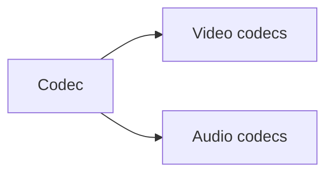

# Media

**Big picture:** a codec compresses pictures or samples. The later pages are the codecs in use.

## Reading order

1. [Codec](codec.md): encode, decode, the bitstream, and the container around it.
2. [Video codecs](video-codecs.md): delivery and editing codecs, and why some have two names.
3. [Audio codecs](audio-codecs.md): lossy, lossless, and uncompressed.

